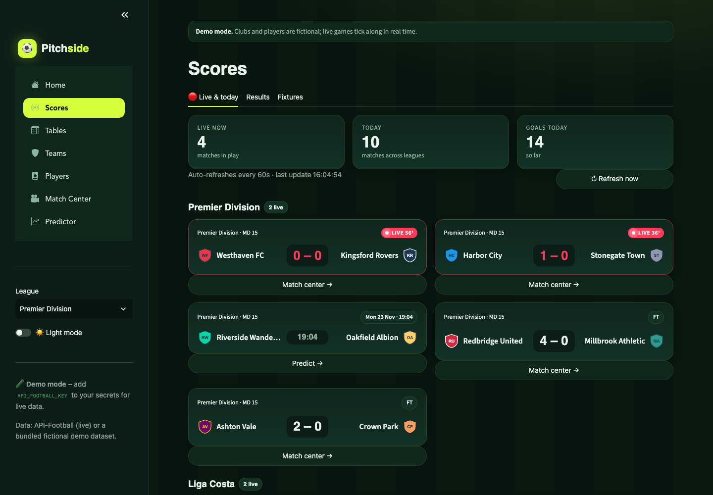
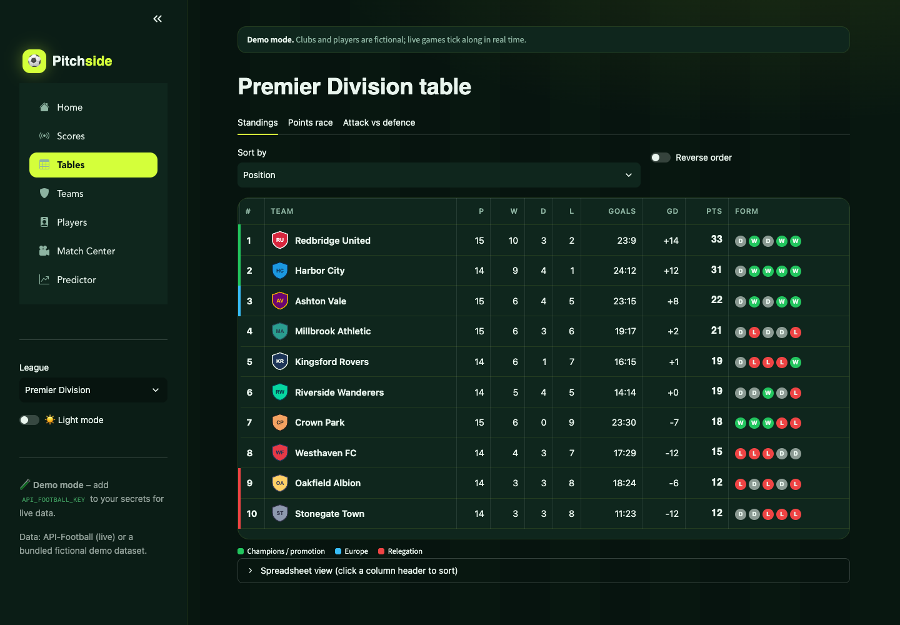
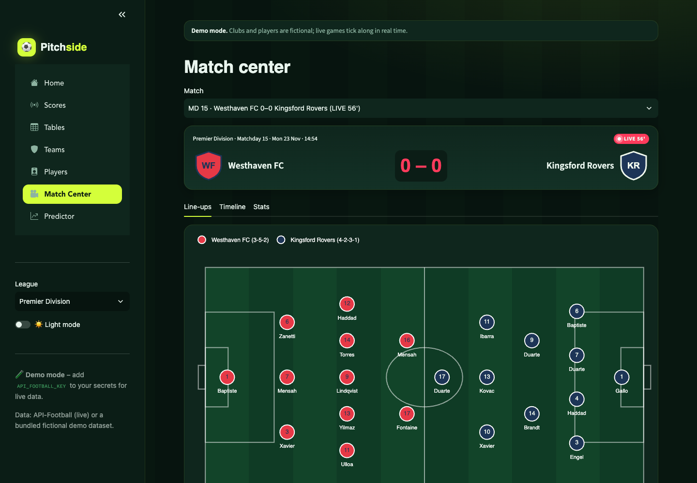
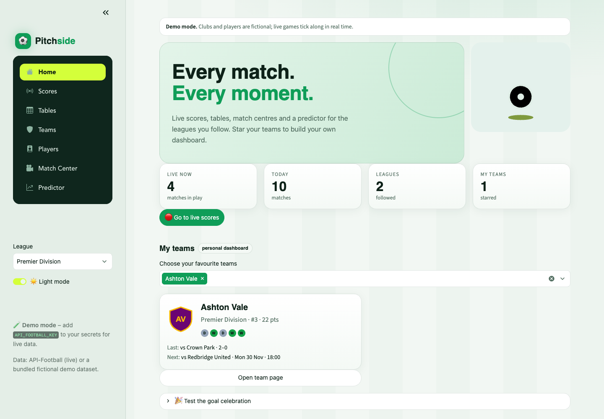

# ⚽ Pitchside

A football companion web app built with Streamlit: live scores, league tables, team pages, a player
explorer with radar comparisons, a match center with line-ups on a pitch, and a Poisson match predictor.
Dark pitch-green design with a lime accent, plus a light mode.

It runs **without an API key** on a bundled demo dataset (fictional clubs and players, with live games
that tick along in real time). Add an [API-Football](https://www.api-football.com/) key for real data.

| Scores | Table |
| :-: | :-: |
|  |  |
| **Match center** | **Light mode** |
|  |  |

## Features

| Page | What it does |
| :- | :- |
| **Home** | Hero with a Lottie animation, today's numbers, and a personal **My teams** dashboard (position, form, last and next match). |
| **Scores** | Today's matches grouped by league, auto-refreshing every 60 s with a pulsing LIVE badge. Balloons, a toast and a goal animation when a favourite team scores. Results and fixtures tabs. |
| **Tables** | Standings with W/D/L form dots and zone colours (title, Europe, relegation), sortable by any column. Animated bar-chart race of points by matchday. Attack-vs-defence scatter plot. |
| **Teams** | Crest, ☆ favourite toggle, KPIs, squad list, results, fixtures and a form chart. |
| **Players** | Filter by league, team, position, age, minutes and name. Radar chart comparing two players as percentiles (per 90 minutes). |
| **Match Center** | Line-ups on a Plotly pitch, an event timeline (goals, cards, subs) and possession/shots bars. Refreshes every 60 s while the match is live. |
| **Predictor** | Poisson model on recent form: win/draw/loss gauges, expected goals, a heatmap of scorelines, and what-if sliders (attack, defence, home advantage, form window). |

## Run it locally

Requires Python 3.11+ (3.12 recommended).

```bash
cd football-app
python3 -m venv .venv
source .venv/bin/activate            # Windows: .venv\Scripts\activate
pip install -r requirements.txt
streamlit run app.py                 # opens http://localhost:8501
```

That's demo mode. For live data:

```bash
cp .streamlit/secrets.toml.example .streamlit/secrets.toml
# edit .streamlit/secrets.toml and paste your API-Football key
streamlit run app.py
```

Run the tests (they don't need Streamlit running):

```bash
python -m unittest
```

## Live data (API-Football)

1. Create a free account at <https://dashboard.api-football.com> and copy your key.
2. Set these three secrets:

   | Secret | Example | Meaning |
   | :- | :- | :- |
   | `API_FOOTBALL_KEY` | `abc123…` | Your key. Without it the app stays in demo mode. |
   | `API_FOOTBALL_SEASON` | `2023` | Season start year. **The free plan only covers some past seasons**, so check which ones your dashboard allows. |
   | `API_FOOTBALL_LEAGUES` | `39,140` | League ids: 39 Premier League, 140 La Liga, 78 Bundesliga, 135 Serie A, 61 Ligue 1. |

3. A sidebar toggle switches between live and demo data. If an API call fails (bad key, daily limit, network),
   the app switches to demo data and shows a banner explaining why.

**Request budget.** The free plan allows 100 requests a day. Responses are cached with `st.cache_data`:
fixtures for 60 s, players and squads for 24 h, finished match details for 24 h. One league's fixtures call also
supplies its teams and table. Leaving the Scores page open re-fetches fixtures once a minute per league, which
uses the daily quota in a little over an hour with two leagues. Close the tab or switch to demo mode when you
aren't watching.

## Project structure

```
app.py                    entry point: page config, theme, sidebar navigation, routing
views/                    one module per page (home, scores, tables, teams, players, match_center, predictor)
components/               reusable UI: theme + CSS injection, cards, standings table, pitch, charts, crests, Lottie
services/
  api.py                  Streamlit data layer: source selection, caching, demo fallback
  data_source.py          DemoSource + ApiFootballSource (no Streamlit import, unit-tested)
  predictor.py            Poisson match model
  standings.py            table, form, zones, points per matchday
  player_stats.py         per-90 rates and percentiles for the radar
  layout.py, favorites.py pitch coordinates, favourite-goal detection
assets/styles.css         custom CSS (Google Fonts: Outfit + Inter)
assets/lottie/*.json      bundled animations (generated by scripts/make_lottie.py)
data/sample/demo.json     demo dataset (generated by scripts/make_sample_data.py, seeded)
.streamlit/config.toml    base theme
tests/                    unittest suite
Dockerfile                container for Render / Hugging Face Spaces
```

## Deploy to Streamlit Community Cloud

1. **Push to GitHub.** The repo root must contain `app.py` and `requirements.txt`. `.gitignore` already keeps
   `.streamlit/secrets.toml` and `.venv/` out of git.
   ```bash
   git init && git add . && git commit -m "Initial commit"
   git branch -M main
   git remote add origin https://github.com/<you>/<repo>.git
   git push -u origin main
   ```
2. Go to <https://share.streamlit.io> and sign in with GitHub.
3. Click **Create app** → **Deploy a public app from GitHub**.
4. Pick the **repository**, **branch** `main` and **main file path** `app.py`.
   (If the app lives in a subfolder of the repo, enter e.g. `football-app/app.py`.)
5. Open **Advanced settings**:
   - **Python version:** 3.12
   - **Secrets:** paste the contents of `.streamlit/secrets.toml.example` with your real key. Skip this for a demo-only app.
6. Click **Deploy**. The first build takes 2–4 minutes. You get a public URL like `https://<name>.streamlit.app`.
7. To change secrets later: app menu (⋮) → **Settings** → **Secrets**. The app restarts on its own.

## Deploy with Docker (Render, Hugging Face Spaces)

```bash
docker build -t pitchside .
docker run -p 8501:8501 -e API_FOOTBALL_KEY=your-key pitchside   # the key is optional
```

The app reads `API_FOOTBALL_KEY`, `API_FOOTBALL_SEASON` and `API_FOOTBALL_LEAGUES` from environment variables
when there is no `secrets.toml`.

- **Render:** New → Web Service → connect the repo → Runtime **Docker**. Add the variables under
  *Environment*. Render sets `PORT` and the image uses it.
- **Hugging Face Spaces:** create a Space with SDK **Docker**, push this folder, and add
  `PORT=7860` plus your key under *Settings → Variables and secrets*.

## Troubleshooting

| Problem | Fix |
| :- | :- |
| `ModuleNotFoundError` or a failed build on Streamlit Cloud | Check that `requirements.txt` is at the root (or next to `app.py` in a subfolder) and that Python 3.12 is selected. Pinned versions need Python 3.11+. Reboot the app from the ⋮ menu after changing requirements. |
| `pip` can't resolve versions locally | Use a fresh virtual environment with Python 3.11–3.13: `python3 -m venv .venv`. |
| Yellow "Live data unavailable" banner | The banner shows the API's reason. Common ones: wrong key (HTTP 403), daily limit reached (resets at 00:00 UTC), or a season your plan doesn't include. Switch `API_FOOTBALL_SEASON` to an allowed season. |
| Rate limits | 100 requests/day on the free plan. Follow one league, close the Scores tab when you're not watching, or use demo mode while developing. |
| First load is slow on Streamlit Cloud | Free apps sleep after inactivity, and waking one ("cold start") takes 30–60 s. After that, cached data makes pages fast. |
| Empty tables or no live games with real data | Off-season, or the chosen season has finished: there's nothing live. Tables and results still work. |
| Animations or the menu are missing | `streamlit-lottie` / `streamlit-option-menu` failed to install. The app falls back to no animation and a radio menu. Reinstall the requirements. |
| Crests or photos are missing | Image hosts sometimes block hot-linking. The app shows generated badges instead. |

## Notes on the data

- The demo dataset is **fictional**. Club names, players and stats are generated from a fixed seed
  (`python scripts/make_sample_data.py` rebuilds it). Kickoff times are relative to when the app starts,
  so there's always a current matchday with finished, live and upcoming games.
- The predictor is a teaching model. It knows recent goals and nothing else: no injuries, schedule or transfers.
  Use the sliders to add what it can't see.
